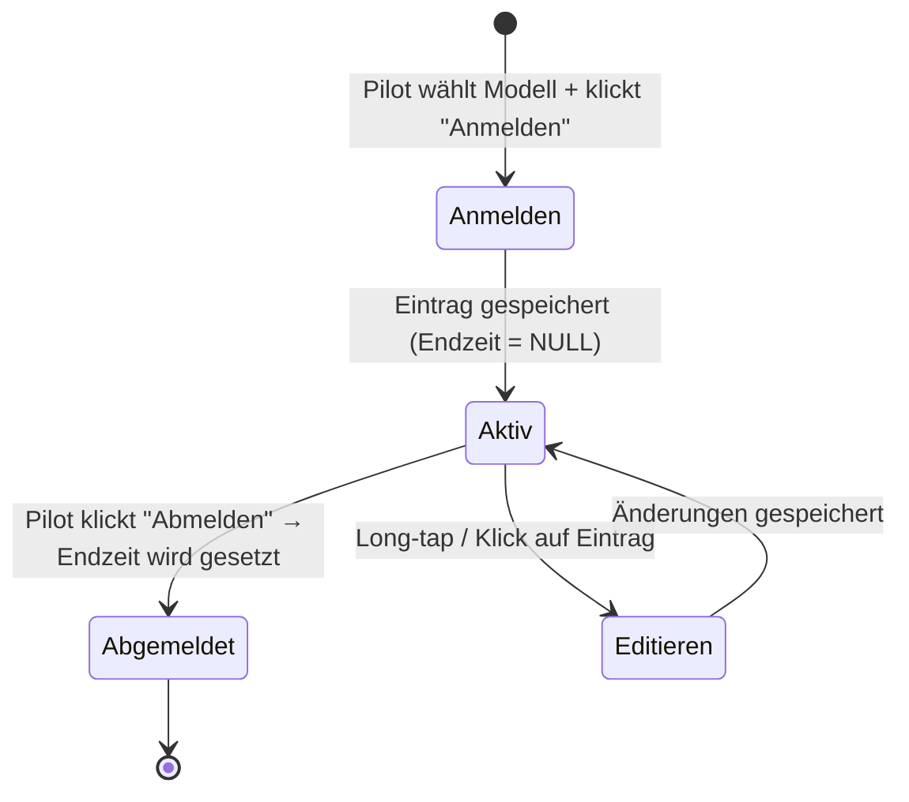

# Spezifikation: Flugbuch-App (Web)

> **Version:** 0.2 – Aktualisiert  
> **Datum:** 2026-03-03  
> **Autor:** Projekt Flugbuch  
> **Referenz:** MFSD-Flugbuch-App V.4.0.0.0, Handbuch Stand 05.02.2025

---

## 1. Ausgangslage & Motivation

### 1.1 Bestehende MFSD-App — Was funktioniert

Die MFSD-Flugbuch-App erfüllt die Dokumentationspflicht gemäß StRfF (Ziff. 8.1.7) und bietet:

| Feature | Beschreibung |
|---|---|
| **Stammdaten** | Piloten, Modelle, Gelände mit QR-Code-Import |
| **Flugerfassung** | An-/Abmeldung, Einzelflüge, Multi-Modellauswahl, Timer |
| **Flugleiter** | Separate Erfassung des Flugleiterdienstes |
| **Export** | FBD (XML), CSV, PDF |
| **Betriebsmodi** | Zentral (ein Gerät), dezentral (mehrere Geräte FTP) |
| **Plattformen** | Windows, Android, iOS 16 |

### 1.2 Kritik an der bestehenden Lösung

| Problem | Details |
|---|---|
| **UI veraltet** | Windows-App wirkt optisch nicht zeitgemäß |
| **Datenaustausch umständlich** | FTP-Upload manuell oder per E-Mail — fehleranfällig, kein Echtzeit-Sync |
| **Kein zentrales Backend** | Daten liegen als Dateien auf einem FTP-Server, keine echte Datenbank |
| **Keine Echtzeit-Zusammenarbeit** | Flugbuch-Konsolidierung erfordert manuelle Import-Schritte |
| **Fehlerkorrektur aufwändig** | Exportierte Datensätze können nur vom Server-Admin gelöscht werden |

### 1.3 Ziel

Eine **moderne Web-App** als Ersatz, die:

1. Optisch ansprechend und responsiv ist (Desktop + Smartphone)
2. Daten **sofort zentral** in einer Datenbank speichert — kein FTP, kein E-Mail
3. Alle Vereinsmitglieder in **Echtzeit** dasselbe Flugbuch sehen
4. Benutzer- und Modellverwaltung integriert
5. Die funktionalen Anforderungen der StRfF (Dokumentationspflicht) erfüllt

---

## 2. Architektur-Vorschlag

### 2.1 Übersicht

```
┌─────────────────────┐
│   Browser / PWA     │  ← Responsives Web-Frontend
│   (HTML/JS/CSS)     │
└────────┬────────────┘
         │ HTTPS (REST API)
┌────────▼────────────┐
│   Backend (Python)  │  ← FastAPI o.ä.
│   + Auth (JWT)      │
└────────┬────────────┘
         │
┌────────▼────────────┐
│ PostgreSQL / SQLite │  ← Zentrale Datenbank
└─────────────────────┘
```

### 2.2 Warum Web statt Desktop/FTP

| Aspekt | MFSD (alt) | Web-App (neu) |
|---|---|---|
| Datenspeicherung | Lokal + FTP-Dateien | Zentrale DB |
| Synchronisation | Manueller Export/Import | Automatisch, Echtzeit |
| Zugriff | App installieren | Browser öffnen |
| Mehrbenutzerbetrieb | FTP-Konflikte möglich | DB-Transaktionen, konsistent |
| Fehlerkorrektur | Nur Server-Admin | Berechtigte User direkt |
| Gastzugang | QR-Code mit FTP-Daten | Link + Tages-Token |

### 2.3 Technologie-Stack (Vorschlag)

| Schicht | Technologie | Begründung |
|---|---|---|
| **Frontend** | HTML + Vanilla JS + CSS (oder Vite/Vue) | Leichtgewichtig, PWA-fähig |
| **Backend** | Python / FastAPI | Passt zu Deinen Kenntnissen, async-fähig |
| **Datenbank** | PostgreSQL (Produktion) / SQLite (Entwicklung) | Robust, erweiterbar |
| **Auth** | JWT (JSON Web Tokens) | Stateless, einfach integrierbar |
| **Hosting** | zum testen Docker auf bestehendem Server (`antannah.blausee.eu`) | Infrastruktur vorhanden |
| **Reverse Proxy** | Traefik (bereits vorhanden) | TLS-Terminierung |

---

## 3. Datenmodell

### 3.1 Entity-Relationship-Diagramm

```
┌──────────┐       ┌──────────────┐       ┌──────────────┐
│  Verein  │1────n│    User      │1────n│   Modell     │
│          │       │  (Pilot)     │       │              │
└──────────┘       └──────┬───────┘       └──────────────┘
                          │ 1
                          │
                          │ n
                   ┌──────▼───────┐
                   │  Flugeintrag │
                   │              │──n───1─┬──────────────┐
                   └──────┬───────┘       │   Gelände    │
                          │               └──────────────┘
                          │ 0..1
                   ┌──────▼───────┐
                   │  Flugleiter- │
                   │  dienst      │
                   └──────────────┘
```

### 3.2 Tabellen-Definition

#### `verein` — Vereinsverwaltung

| Spalte | Typ | Beschreibung |
|---|---|---|
| `id` | UUID, PK | Eindeutige ID |
| `name` | VARCHAR(100), NOT NULL | Vereinsname |
| `created_at` | TIMESTAMP | Erstelldatum |

#### `user` — Piloten / Benutzer

| Spalte | Typ | Beschreibung |
|---|---|---|
| `id` | UUID, PK | Eindeutige ID |
| `verein_id` | UUID, FK → verein | Zugehöriger Verein |
| `vorname` | VARCHAR(50), NOT NULL | Vorname |
| `nachname` | VARCHAR(50), NOT NULL | Nachname |
| `email` | VARCHAR(100), UNIQUE | Login-E-Mail |
| `passwort_hash` | VARCHAR(255) | Bcrypt-Hash |
| `hat_schulungsnachweis` | BOOLEAN, DEFAULT FALSE | Schulungsnachweis vorhanden |
| `hat_flugordnung_bestaetigt` | BOOLEAN, DEFAULT FALSE | Bestätigung der StRfF und Flugordnung |
| `rolle` | ENUM('pilot', 'flugleiter', 'admin') | Berechtigungsrolle |

| `ist_gast` | BOOLEAN, DEFAULT FALSE | Gastzugang (zeitlich begrenzt) |
| `gast_gueltig_bis` | DATE, NULLABLE | Ablaufdatum für Gäste |
| `created_at` | TIMESTAMP | Erstelldatum |
| `updated_at` | TIMESTAMP | Letzte Änderung |

#### `modell` — Flugmodelle

| Spalte | Typ | Beschreibung |
|---|---|---|
| `id` | UUID, PK | Eindeutige ID |
| `user_id` | UUID, FK → user | Besitzer des Modells |
| `bezeichnung` | VARCHAR(100), NOT NULL | Name / Bezeichnung des Modells |
| `modell_typ` | ENUM('motorflugzeug', 'segelflugzeug', 'hubschrauber', 'multikopter', 'luftschiff', 'ballon', 'gleitschirm', 'rakete', 'sonstige') | Modelltyp |
| `antrieb` | ENUM('elektro', 'verbrenner', 'turbine', 'raketenantrieb', 'ohne', 'sonstige') | Antriebsart |
| `gewichtsklasse` | ENUM('bis_250g', 'bis_2kg', 'bis_4kg', 'bis_12kg', 'bis_25kg', 'ueber_25kg') | Gewichtsklasse |
| `frequenz` | VARCHAR(20), NULLABLE | Vorbelegt mit "2.4 GHz", überschreibbar für Alt-Systeme (35/40 MHz) |
| `registriernummer` | VARCHAR(50), NULLABLE | UAS-Registriernummer |
| `aktiv` | BOOLEAN, DEFAULT TRUE | Modell ist aktiv / nicht gelöscht |
| `created_at` | TIMESTAMP | Erstelldatum |
| `updated_at` | TIMESTAMP | Letzte Änderung |

> **Hinweis:** In der MFSD-App werden Modelle auch als Gruppen-Eintrag genutzt (z.B. „alle E-Flieger bis 12 kg"). Diese Flexibilität bleibt erhalten — ein Modell-Eintrag kann ein Einzelmodell oder eine Gruppe repräsentieren.

#### `gelaende` — Fluggelände

| Spalte | Typ | Beschreibung |
|---|---|---|
| `id` | UUID, PK | Eindeutige ID |
| `verein_id` | UUID, FK → verein | Zugehöriger Verein |
| `bezeichnung` | VARCHAR(100), NOT NULL | Geländename (z.B. „MFG Uetze") |
| `strasse` | VARCHAR(100), NULLABLE | Adresse |
| `plz` | VARCHAR(10), NULLABLE | PLZ |
| `ort` | VARCHAR(100), NULLABLE | Ort |
| `koordinaten_lat` | DECIMAL(10,7), NULLABLE | Breitengrad (optional) |
| `koordinaten_lon` | DECIMAL(10,7), NULLABLE | Längengrad (optional) |
| `created_at` | TIMESTAMP | Erstelldatum |

#### `flugeintrag` — Haupttabelle: Flugbucheinträge

| Spalte | Typ | Beschreibung |
|---|---|---|
| `id` | UUID, PK | Eindeutige ID |
| `user_id` | UUID, FK → user, NOT NULL | Pilot |
| `modell_id` | UUID, FK → modell, NULLABLE | Verwendetes Modell (NULL bei Flugleiterdienst) |
| `gelaende_id` | UUID, FK → gelaende, NOT NULL | Gelände |
| `datum` | DATE, NOT NULL | Flugtag |
| `startzeit` | TIME, NOT NULL | Beginn |
| `endzeit` | TIME, NULLABLE | Ende (NULL = noch aktiv) |
| `ist_flugleiter` | BOOLEAN, DEFAULT FALSE | Eintrag ist Flugleiterdienst |
| `bemerkungen` | TEXT, NULLABLE | Freitextfeld |
| `created_at` | TIMESTAMP | Erstellzeitpunkt |
| `updated_at` | TIMESTAMP | Letzte Änderung |

---

## 4. Formular-Design: Flugeintrag

### 4.1 Hauptansicht — Tagesübersicht

```
┌─────────────────────────────────────────────────┐
│  🛩  FLUGBUCH                  [Pilot ▾] [⎋]    │
│─────────────────────────────────────────────────│
│                                                 │
│  ┌─── Neuer Eintrag ──────────────────────┐    │
│  │                                         │    │
│  │  ○ Modellflug   ○ Flugleiterdienst     │    │
│  │                                         │    │
│  │  Modell:  [Zephyr F5J              ▼]  │    │
│  │                                         │    │
│  │       [ ▶ Jetzt Starten ]              │    │
│  │       [ 🕐 Zeit nachmelden ]           │    │
│  └─────────────────────────────────────────┘    │
│                                                 │
│  ── Heutige Einträge ──────────────────────     │
│  ┌──────┬────────┬───────┬───────┬────────┐    │
│  │Pilot │Modell  │Start  │Ende   │Status  │    │
│  ├──────┼────────┼───────┼───────┼────────┤    │
│  │Max M.│Zephyr  │10:30  │──:──  │🟢 aktiv│    │
│  │Anna K│ASH 31  │09:15  │11:45  │⚪ fertig│    │
│  │Peter │⛑ FL   │08:00  │10:00  │⚪ fertig│    │
│  └──────┴────────┴───────┴───────┴────────┘    │
│                                                 │
│           [ 📄 CSV ]  [ 📄 PDF ] (nur Admin)    │
└─────────────────────────────────────────────────┘
```

> **Hinweis:** Die Datumsauswahl entfällt auf der Hauptseite – es wird immer das aktuelle Datum ("heute") verwendet. Für nachträgliche Einträge steht der Button **"Zeit nachmelden"** zur Verfügung, der ein Formular mit Datum, Startzeit und Endzeit aufklappt.

### 4.2 Formular-Felder im Detail

| Feld | Typ | Pflicht | Quelle | Bemerkung |
|---|---|---|---|---|
| **Pilot** | Dropdown | ✅ | user-Tabelle (gefiltert nach Verein) | Vorauswahl: eingeloggter User |
| **Gelände** | Dropdown | ✅ | gelaende-Tabelle | Vorauswahl: Vereinsgelände |
| **Datum** | Date-Picker | ✅ | Default: heute | Nur im \"Zeit nachmelden\"-Formular sichtbar |
| **Typ** | Radio | ✅ | „Modellflug" / „Flugleiterdienst" | Blendet Modell-Felder bei FL aus |
| **Modell** | Dropdown | ✅ (bei Modellflug) | modell-Tabelle des Piloten | |
| **Startzeit** | Time-Picker | ✅ | Automatisch (aktuelle Uhrzeit) | Im Nachmelde-Formular frei wählbar |
| **Endzeit** | Time-Picker | ❌ | Leer bei Anmeldung | Wird bei Abmeldung gesetzt, im Nachmelde-Formular Pflichtfeld |
| **Bemerkungen** | Textarea | ❌ | Freitext | |

### 4.3 Workflow



---

## 5. Benutzerverwaltung

### 5.1 Rollen & Berechtigungen

| Rolle | Beschreibung | Berechtigungen |
|---|---|---|
| **Admin** | Vereinsadministrator | Alles: User anlegen/löschen, Gelände verwalten, alle Einträge editieren/löschen, Export |
| **Flugleiter** | Pilot mit Flugleiter-Berechtigung | Eigene Einträge + Flugleiterdienst erfassen, alle Einträge des Tages sehen |
| **Pilot** | Normales Vereinsmitglied | Eigene Einträge erfassen, eigene Modelle verwalten, Tages-Flugbuch einsehen, eigenes Profil bearbeiten |
| **Gast** | Tagesgast | Eigene Einträge erfassen (nur Tageszugang), keine Modellverwaltung |

### 5.2 Benutzerprofil (Self-Service)

Jeder Benutzer kann über ein **Dropdown-Menü** (Klick auf den eigenen Namen in der Navigationsleiste) folgende Einstellungen selbst verwalten:

| Einstellung | Beschreibung |
|---|---|
| **Vorname / Nachname** | Eigenes Profil bearbeiten |
| **Schulungsnachweis** | Toggle: Schulungsnachweis vorhanden (Selbstauskunft) |
| **Flugordnung** | Toggle: Bestätigung der StRfF und Flugordnung |
| **Passwort** | Eigenes Passwort ändern |

> **Hinweis:** Der Schulungsnachweis und die Flugordnungsbestätigung werden nicht bei der Benutzererstellung durch den Admin gesetzt, sondern vom Benutzer selbst im Profil aktiviert.

### 5.3 Benutzerverwaltung (Admin)

Admins können neue Benutzer anlegen (Vorname, Nachname, E-Mail, Passwort) und Admin-Rechte über einen **Toggle-Schalter** vergeben/entziehen.

### 5.4 Modellverwaltung

Modelle sind über einen Button neben der Modellauswahl im Dashboard erreichbar. Modelle können **erstellt, bearbeitet und gelöscht** werden. Das Frequenz-Feld ist mit **"2.4 GHz"** vorbelegt.

### 5.5 Gastzugang

Statt QR-Code mit FTP-Daten → **Einladungslink** mit Tages-Token:

```
https://flugbuch.mfg-uetze.de/gast?token=abc123&datum=2026-03-03
```

- Der Admin generiert den Link (gültig für einen Tag)
- Gast gibt Name + Modelltyp ein → kann Flüge loggen
- Nach 23:59 Uhr verfällt der Zugang automatisch

---

## 6. Modellverwaltung

### 6.1 Modell-Editor (Formular)

| Feld | Beschreibung | MFSD-Äquivalent |
|---|---|---|
| **Bezeichnung** | Freitext, z.B. „Zephyr F5J" | Bezeichnung |
| **Modelltyp** | Dropdown: Motorflugzeug, Segelflugzeug, Hubschrauber, Multikopter, Sonstige | ModellTypCodes |
| **Antrieb** | Dropdown: Elektro, Verbrenner, Turbine, Ohne, Sonstige | MotorTypCodes |
| **Gewichtsklasse** | Dropdown: ≤250g, ≤2kg, ≤4kg, ≤12kg, ≤25kg, >25kg | GewichtsKlasse |
| **Registriernummer** | Optional, Registriernummer >25kg | Registriernummer>25kg |
| **Aktiv** | Toggle — deaktivierte Modelle erscheinen nicht in der Auswahl | (neu) |
| **Kanal** | Funkfrequenz | Funkfrequenz 2,4 GHz oder Kanalnummer bei 35 MHz |

### 6.2 Modell-Gruppen

Analog zur MFSD-App kann ein Modell-Eintrag als **Sammel-Eintrag** dienen:
- Bezeichnung: z.B. „E-Segler bis 4 kg"
- Antrieb: Mehrfachauswahl möglich (über Array/JSON in der DB)
- So reicht ein Eintrag pro Tag gemäß StRfF-Mindestanforderung

---

## 7. API-Endpunkte (REST)

### 7.1 Authentifizierung

| Methode | Pfad | Beschreibung |
|---|---|---|
| POST | `/api/auth/login` | Login → JWT |
| POST | `/api/auth/gast` | Gastzugang mit Tages-Token |
| POST | `/api/auth/refresh` | Token erneuern |

### 7.2 User

| Methode | Pfad | Beschreibung |
|---|---|---|
| GET | `/api/users` | Alle Piloten des Vereins |
| POST | `/api/users` | Neuen Piloten anlegen (Admin) |
| PUT | `/api/users/{id}/rolle` | Benutzerrolle ändern (Admin) |
| PUT | `/api/users/{id}/passwort` | Passwort zurücksetzen (Admin) |
| PUT | `/api/users/me/profil` | Eigenes Profil bearbeiten (Self-Service) |
| PUT | `/api/users/me/passwort` | Eigenes Passwort ändern (Self-Service) |
| DELETE | `/api/users/{id}` | Piloten löschen (Admin) |

### 7.3 Modelle

| Methode | Pfad | Beschreibung |
|---|---|---|
| GET | `/api/users/{id}/modelle` | Modelle eines Piloten |
| POST | `/api/modelle` | Neues Modell anlegen |
| PUT | `/api/modelle/{id}` | Modell bearbeiten |
| DELETE | `/api/modelle/{id}` | Modell deaktivieren |

### 7.4 Flugeinträge

| Methode | Pfad | Beschreibung |
|---|---|---|
| GET | `/api/flugbuch?datum=2026-03-03&gelaende_id=...` | Tages-Flugbuch |
| POST | `/api/flugbuch` | Neuen Eintrag (Anmeldung) |
| PUT | `/api/flugbuch/{id}` | Eintrag bearbeiten (Abmeldung, Korrektur) |
| DELETE | `/api/flugbuch/{id}` | Eintrag löschen (Admin) |
| POST | `/api/flugbuch/abmelden` | Alle offenen Einträge eines Piloten abmelden |

### 7.5 Export

| Methode | Pfad | Beschreibung |
|---|---|---|
| GET | `/api/export/pdf?von=...&bis=...` | PDF-Export |
| GET | `/api/export/csv?von=...&bis=...` | CSV-Export |

### 7.6 Gelände

| Methode | Pfad | Beschreibung |
|---|---|---|
| GET | `/api/gelaende` | Alle Gelände des Vereins |
| POST | `/api/gelaende` | Neues Gelände anlegen (Admin) |
| PUT | `/api/gelaende/{id}` | Gelände bearbeiten (Admin) |

---

## 8. Export & Kompatibilität

### 8.1 Unterstützte Exportformate

| Format | Zweck |
|---|---|
| **PDF** | Druckbares Flugbuch, analog zum MFSD-PDF-Export |
| **CSV** | Maschinenlesbar, zur Weiterverarbeitung |


### 8.2 FBD-Import (optional, Phase 2)

Für die Migration bestehender Daten aus der MFSD-App:
- Import-Endpunkt für `.fbd`-Dateien (XML)
- Stammdaten-Import aus `.fbs`-Dateien (CSV)

---

## 9. Verbesserungen gegenüber MFSD

| Feature | MFSD | Neu |
|---|---|---|
| **Datenspeicherung** | Lokal + FTP-Dateien | Zentrale PostgreSQL-DB |
| **Synchronisation** | Manueller FTP-Upload | Sofort bei Speichern (REST API) |
| **UI** | Native Windows/Android-App | Responsives Web (PWA-fähig) |
| **Gastzugang** | QR-Code mit FTP-Credentials | Einladungslink mit Tages-Token |
| **Fehlerkorrektur** | Nur Server-Admin | Berechtigte User direkt im Web |
| **Mehrbenutzer** | FTP-Dateikonflikte | DB-Transaktionen, Race-Condition-frei |
| **Offline-Fähigkeit** | Vorhanden (lokal) | PWA mit Service Worker (Phase 2) |
| **Statistiken** | Nicht vorhanden | Dashboard: Flugstunden/Pilot, Modelle, etc. |

---

## 10. Nicht-funktionale Anforderungen

| Anforderung | Spezifikation |
|---|---|
| **Verfügbarkeit** | 99 % (Hobby-Projekt, Docker-Restart-Policy) |
| **Datenschutz** | DSGVO-konform, Daten nur innerhalb des Vereins |
| **Backup** | Tägliches DB-Dump (Cron-Job im Docker-Container) |
| **Performance** | < 500 ms Antwortzeit für API-Calls |
| **Responsive** | Nutzbar auf Smartphone, Tablet, Desktop |
| **Sicherheit** | HTTPS (Traefik), Passwort-Hashing (bcrypt), JWT mit Expiry |

---

## 11. Phasenplanung

| Phase | Inhalt |
|---|---|
| **Phase 1** | Backend (FastAPI + DB), Auth, Flugeintrag-CRUD, einfaches Web-Frontend |
| **Phase 2** | Modellverwaltung, Benutzerverwaltung, PDF/CSV-Export |
| **Phase 3** | Dashboard / Statistiken, PWA, Offline-Fähigkeit |
| **Phase 4** |  Gastzugang, QR-Code-Scan |
| **Phase 5** | FBD-Import (MFSD-Migration) |
---

## 12. Offene Fragen

1. **Vereinsübergreifend?** Soll die App von Anfang an mehrere Vereine unterstützen oder zunächst nur für euren Verein?
*Entscheidung:* Nur für den eigenen Verein (Modellfluggemeinschaft Kitzingen e.V. - MFGKT).

2. **Offline-Modus?** Wie wichtig ist Offline-Fähigkeit (kein Empfang auf dem Flugplatz)?
*Entscheidung:* Wird für die erste Version zurückgestellt (Phase 3).

3. **MFSD-Kompatibilität?** Soll ein FBD-Import/Export für Migration beibehalten werden?
*Entscheidung:* Nein, nicht erforderlich.

4. **Dashboard?** Welche Statistiken sind gewünscht?
*Entscheidung:* Flugstunden, Besucherstunden, Modellstunden, Anzahl der Flüge. Sowie eine Häufigkeitsverteilung der Flüge (Wochentags vs. Wochenende).

5. **Unterschrift?** Die MFSD-App unterstützt Piloten-Unterschriften. Ist das weiterhin relevant? Welche Alternativen gibt es?
*Lösung:* Die Bestätigung der StRfF und der Flugordnung erfolgt **im Benutzerprofil** als Toggle-Schalter ("Flugordnung bestätigt"). Das Feld `hat_flugordnung_bestaetigt` wird auf dem User-Modell gespeichert und bei jedem Flugeintrag automatisch in den Flugeintrag übernommen. Da der Pilot authentifiziert ist (gesicherter Login via Token) und die Bestätigung in der Datenbank als Boolean auf dem User-Profil gespeichert wird, gilt dies im geschlossenen System des Vereins als revisionssichere Willenserklärung.

6. **QR-Code?** Die MFSD-App unterstützt QR-Code-Scan. Ist das weiterhin relevant? 
*Lösung:* Ja. Ein Gelände-QR-Code ist meist ein einfacher kodierter String (z.B. `Gelaende#MFG_Kitzingen`). Wir haben in der Datenbank das Feld `qr_code_string` vorgesehen. In Phase 4 können wir den Kamera-Scanner im Browser via JavaScript (`html5-qrcode`) aktivieren. Scannt ein Pilot den Code am Platz, wird das Gelände im Dropdown sofort vorausgewählt.

7. **DSGVO?** Ist es zulässig, dass Namen und Modelle der User in der Liste für alle sichtbar sind?
*Bewertung:* Innerhalb eines *geschlossenen, durch Login gesicherten Bereichs* eines Vereins ist die Sichtbarkeit der aktiven Piloten aus Sicherheits- und Koordinationsgründen (Flugleiter-Prinzip, Frequenzüberwachung) in der Regel durch das "berechtigte Interesse" (Art. 6 Abs. 1 lit. f DSGVO) abgedeckt. Es werden keine übermäßigen privaten Daten (wie Wohnort oder Alter) geteilt, sondern nur der flugbetriebliche Status.


## 13. Testplan

Um die Stabilität der Applikation zu gewährleisten, werden folgende Testroutinen durchgeführt:

1. **Backend-Tests (Automatisierte Unit-Tests mit `pytest`)**
   - *Authentifizierung:* Prüfen, ob bei falschem Passwort der Login verwehrt wird und ob Gast-Tokens nach Ablaufdatum ungültig werden.
   - *Rollen & Berechtigungen:* Sicherstellen, dass nur Admins neue Locations (`Gelaende`) anlegen können, Piloten aber nicht.
   - *Flugbuch-Logik:* Überprüfen, ob das Beenden eines Fluges die aktuelle Uhrzeit korrekt in die Datenbank als `endzeit` schreibt und keine abgeschlossenen Flüge mehr in der "aktiv" Zählung auftauchen.

2. **Frontend UI/UX Tests (Manuelles Testen / Browser-Automatisierung)**
   - *Responsive Design:* Prüfen der Ansichten (Login, Dashboard, Modelle) auf mobilen Geräten (Viewport < 600px).
   - *Formular-Validierungen:* Verhindern, dass ein Flug ohne beständige Checkbox oder ohne ausgewähltes Modell (außer beim Flugleiterdienst) gestartet werden kann.
   - *State Management:* Sicherstellen, dass beim Hinzufügen eines neuen Modells im Modal-Fenster die Dropdown-Liste im Dashboard sofort aktualisiert wird, ohne die Seite neu laden zu müssen.

3. **Integrierte End-to-End Test-Routinen**
   - *Datenintegrität:* Pilot A loggt sich ein, erstellt ein Modell, startet einen Flug. Pilot B loggt sich am selben Gelände ein. Es muss geprüft werden, ob Pilot B den aktiven Flug von Pilot A auf dem Dashboard sehen kann.
   - *Offline-Simulation (Phase 3):* Netzwerkverbindung im Browser-Dev-Tools trennen, Flug eintragen, Netzwerk wiederherstellen und prüfen, ob der Service-Worker die Daten im Hintergrund an die API synchronisiert.
   - *Performance (Last- und Ladezeiten):*
     - *API-Lasttest (Stress Testing):* Simulation von z. B. 50 gleichzeitigen Nutzern (repräsentativ für einen stark besuchten Flugtag oder Wettbewerb). Mit Tools wie `locust` oder `k6` wird verifiziert, dass die API-Antwortzeiten auch unter Last unter der spezifizierten Grenze von 500 ms bleiben.
     - *Latenz-Simulation:* Drosselung der Netzwerkgeschwindigkeit in den Dev-Tools (z. B. auf 3G/Edge-Niveau), um das Verhalten der App bei schlechter Netzabdeckung am Flugplatz zu testen. Das Dashboard sollte dennoch zügig rendern (Ziel: First Contentful Paint < 2s).
   - *Responsive Design & Ergonomie (Mobile Testing):*
     - *Darstellung auf Kleinst-Displays:* Testen der großen Flugbuch-Tabelle (Tagesübersicht) auf schmalen Smartphone-Displays (Hochformat). Prüfen, ob horizontales Scrollen flüssig funktioniert oder ob die Tabelle korrekt in ein Kachel-Design umbricht.
     - *Touch-Ziele & Outdoor-Einsatz:* Sicherstellen, dass die primären Interaktionselemente (Anmelden, Abmelden, Modellwahl) groß genug sind, um sie auch bei ungünstigen Bedingungen (z. B. kalte Hände, Blendwirkung durch Sonnenlicht) zielsicher bedienen zu können. Testen des Kontrasts im Light-Mode für direkte Sonneneinstrahlung.
   - *Sicherheit (Security Testing):*
     - *Autorisierungsprüfung (IDOR - Insecure Direct Object Reference):* Gezielter API-Test auf Backend-Ebene: Es wird versucht, mit dem JWT (JSON Web Token) von `Pilot A` den Flugeintrag oder die Modelldaten von `Pilot B` über direkte Manipulation der Objekt-ID (via `PUT` oder `DELETE`) zu verändern. Das Backend muss dies mit einem 403 Forbidden ablehnen.
     - *Eingabevalidierung (XSS & Injection):* Eingabe von potenziell gefährlichen Zeichenketten (z. B. `<script>alert(1)</script>`) in das Freitextfeld "Bemerkungen". Es muss sichergestellt werden, dass diese Daten sowohl in der Datenbank korrekt escaped werden (PostgreSQL / SQLAlchemy) als auch im Frontend sicher gerendert werden (Schutz vor Cross-Site-Scripting).
     - *Token Expiry:* Simulation abgelaufener JWT-Tokens. Das System muss den Nutzer automatisch ausloggen oder im Hintergrund über den `/api/auth/refresh`-Endpunkt (falls implementiert) einen neuen Token anfordern, ohne dass es zu einem inkonsistenten App-Zustand kommt.
   


